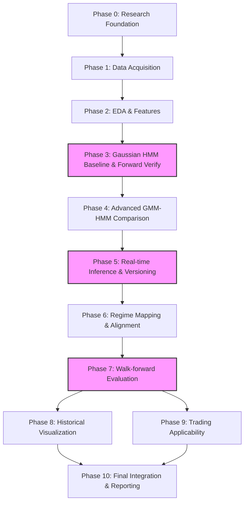

# WORK PLAN: EURUSD M15 Market Regime Detection Using Hidden Markov Models

## TỔNG QUAN DỰ ÁN (PROJECT BACKGROUND)
**Mục tiêu cốt lõi:** Phát triển hệ thống nhận diện trạng thái thống kê hiện tại của thị trường EURUSD trên khung thời gian M15 và ước lượng phân phối xác suất lọc (filtered probability distribution): 
$P(S_t=j \mid O_{1:t})$
Hệ thống không nhằm mục đích dự báo hướng đi của nến tiếp theo, không dự báo giá, và không tối đa hóa lợi nhuận giao dịch. Đầu ra bao gồm: Xác suất lọc thời gian thực, lưu trữ lịch sử xác suất "as-of", diễn giải thống kê các trạng thái, đánh giá walk-forward ngoài mẫu, và một lớp đánh giá ứng dụng giao dịch (trading applicability) độc lập. Không ép buộc mô hình phải có chính xác 3 trạng thái hoặc mọi trạng thái ẩn đều phải ánh xạ cứng nhắc thành Bullish, Sideways, hoặc Bearish nếu dữ liệu không hỗ trợ.

---

## LỘ TRÌNH CÁC GIAI ĐOẠN (PHASES)

### PHASE 0 — Research Foundation and Methodology
1. **Mục tiêu:** Định nghĩa phạm vi nghiên cứu, các giả định toán học, ranh giới giữa nhận diện (detection) và dự báo (prediction).
2. **Lý do cần thiết:** Tránh sai lệch mục tiêu khi triển khai kỹ thuật, đảm bảo không có rò rỉ dữ liệu tương lai (look-ahead bias) ngay từ khâu thiết kế.
3. **Nhiệm vụ chi tiết:**
   - Lập bảng ánh xạ phương pháp luận từ 4 bài báo tham khảo.
   - Định nghĩa toán học cho xác suất lọc (filtered probabilities) $P(S_t | O_{1:t})$, phân biệt rõ với xác suất làm mượt (smoothed probabilities) và giải mã Viterbi toàn chuỗi (full-sequence Viterbi decoding).
   - Thiết lập các giới hạn nghiên cứu: Hệ thống nhận diện trạng thái, không phải hệ thống sinh tín hiệu giao dịch.
   - Ghi nhận các quyết định phương pháp luận chưa chốt (unresolved decisions) để thử nghiệm thực nghiệm.
4. **Phương pháp, thuật toán & toán học:** Lý thuyết Hidden Markov Model, Xác suất và Thống kê chuỗi thời gian.
5. **Công cụ / Thư viện:** LaTeX (cho tài liệu), Markdown.
6. **Đầu ra mong đợi:** Tài liệu RESEARCH_PLAN.md, Methodology decision record.
7. **Tiêu chí hoàn thành:** Phạm vi nghiên cứu được định nghĩa toán học rõ ràng; phân định rạch ròi giữa Filtered, Smoothed và Viterbi.
8. **Phụ thuộc:** Không có.
9. **Rủi ro & Sai lầm thường gặp:** Nhầm lẫn khái niệm giải mã hồi cứu với ước lượng xác suất thời gian thực.

### PHASE 1 — Data Acquisition and Quality Control
1. **Mục tiêu:** Thu thập, kiểm tra chất lượng và xử lý dữ liệu OHLC M15 EURUSD.
2. **Lý do cần thiết:** HMM rất nhạy cảm với cấu trúc chuỗi thời gian. Xử lý sai các khoảng trống thời gian sẽ phá vỡ tính hợp lệ của ma trận chuyển trạng thái. Tuyệt đối không bịa đặt (fabricate) nến OHLC.
3. **Nhiệm vụ chi tiết:**
   - Tải dữ liệu OHLC lịch sử EURUSD M15 (VD: từ Dukascopy hoặc MetaTrader 5).
   - Phân biệt rõ: (1) Khuyết 1 nến trong phiên giao dịch, (2) Khuyết nhiều nến liên tiếp trong phiên, (3) Khoảng trống đóng cửa (Cuối tuần, Lễ), (4) Dữ liệu OHLC không hợp lệ (invalid).
   - Đồng bộ hóa múi giờ và kiểm tra Daylight Saving Time (DST).
   - Trích xuất Tick volume và ghi chú rõ đây không phải là Traded volume tập trung.
4. **Phương pháp, thuật toán & toán học:** Time-series integrity checks, Timezone handling.
5. **Công cụ / Thư viện:** Python, Pandas.
6. **Đầu ra mong đợi:** Raw dataset, Data quality report, Reproducible data-loading scripts.
7. **Tiêu chí hoàn thành:** Tập dữ liệu sạch, có chính sách rõ ràng cho từng loại khoảng trống thời gian, không nội suy dữ liệu giả mạo.
8. **Phụ thuộc:** Phase 0.
9. **Rủi ro & Sai lầm thường gặp:** Nội suy nến cuối tuần làm sai lệch xác suất chuyển trạng thái ngầm.

### PHASE 2 — Exploratory Data Analysis and Feature Engineering
1. **Mục tiêu:** Khám phá phân phối dữ liệu, xây dựng và đánh giá các đặc trưng ứng viên (candidate features) đại diện cho M15.
2. **Lý do cần thiết:** HMM cần đầu vào có phân phối phù hợp. Đặc trưng dư thừa hoặc rò rỉ sẽ làm hỏng mô hình.
3. **Nhiệm vụ chi tiết:**
   - Đánh giá các ứng viên: Close-to-close log return, Open-to-close log body return, High-low log range.
   - Bổ sung định nghĩa đặc trưng râu nến (Wicks) sử dụng giá OHLC:
     * $UpperWick_t = \ln\left(\frac{H_t}{\max(O_t, C_t)}\right)$
     * $LowerWick_t = \ln\left(\frac{\min(O_t, C_t)}{L_t}\right)$
     * *Ý nghĩa tài chính:* Đo lường áp lực từ chối giá (price rejection) tại các vùng đỉnh/đáy cục bộ.
   - Phân tích tính phi chuẩn, biến động cụm và ma trận tương quan.
   - Chạy các thử nghiệm cắt bỏ (ablation experiments) và so sánh ngoài mẫu để chốt tập đặc trưng.
   - Đảm bảo các tham số Scaling chỉ được fit trên tập Train. Kiểm tra kỹ rò rỉ nếu dùng rolling features.
4. **Phương pháp, thuật toán & toán học:** Pearson/Spearman correlation, Phân phối thống kê, Log-transform.
5. **Công cụ / Thư viện:** SciPy, Seaborn, Pandas.
6. **Đầu ra mong đợi:** Báo cáo EDA, Feature definitions, Candidate feature datasets.
7. **Tiêu chí hoàn thành:** Chốt danh sách đặc trưng dựa trên bằng chứng ablation, không mặc định tính độc lập thống kê nếu chưa kiểm định, không rò rỉ tương lai.
8. **Phụ thuộc:** Phase 1.
9. **Rủi ro & Sai lầm thường gặp:** Mặc định các đặc trưng là độc lập; fit Scaler trên toàn bộ tập dữ liệu (leakage).

### PHASE 3 — Gaussian HMM Baseline and Forward Filtering Verification
1. **Mục tiêu:** Cài đặt mô hình Gaussian HMM cơ sở và kiểm chứng chặt chẽ thuật toán Forward Filtering.
2. **Lý do cần thiết:** Thiết lập một mốc chuẩn (baseline) và đảm bảo động cơ tính toán xác suất thời gian thực hoạt động đúng toán học.
3. **Nhiệm vụ chi tiết:**
   - Cài đặt Gaussian HMM, thử nghiệm số lượng trạng thái $K \in \{2, 3, 4\}$. Khởi tạo bằng K-Means.
   - Cài đặt thuật toán Forward Filtering để xuất ra xác suất lọc: 
     $\alpha_t(j) = \left[\sum_{i=1}^{K}\alpha_{t-1}(i)a_{ij}\right] \mathcal{N}(O_t \mid \mu_j, \Sigma_j)$
   - Thực hiện tính toán trong không gian logarit (log-space computation) với `LogSumExp` để tránh numerical underflow.
   - Chuẩn hóa: $P(S_t=j \mid O_{1:t}) = \frac{\alpha_t(j)}{\sum_k \alpha_t(k)}$.
   - **Viết Unit Tests bắt buộc:** 
     1. Chuẩn hóa xác suất ($\sum = 1$).
     2. Tính nhất quán giữa lọc tuần tự (sequential) và lô (batch).
     3. Dữ liệu tương lai không ảnh hưởng đến xác suất lọc quá khứ (khi cố định tham số).
     4. Độ ổn định số học trong không gian logarit.
     5. Khởi tạo đúng đắn trạng thái $\alpha_0$.
   - *Lưu ý quan trọng:* Vượt qua các unit tests này chỉ xác thực hành vi của mã nguồn (implementation behavior) về mặt toán học, hoàn toàn không chứng minh chất lượng hay độ chính xác của mô hình dự báo.
4. **Phương pháp, thuật toán & toán học:** Forward Algorithm, Log-space arithmetic, Expectation-Maximization (EM) cho In-sample.
5. **Công cụ / Thư viện:** Custom Python code cho Inference, `hmmlearn` (chỉ dùng để ước lượng tham số In-sample).
6. **Đầu ra mong đợi:** Baseline model, Verified Forward Filtering implementation, Unit test logs.
7. **Tiêu chí hoàn thành:** Thuật toán Forward vượt qua 100% unit tests, không có hiện tượng underflow.
8. **Phụ thuộc:** Phase 2.
9. **Rủi ro & Sai lầm thường gặp:** Tự động cho rằng hàm `predict_proba()` của thư viện sinh ra Filtered probabilities mà không kiểm tra API thực tế.

### PHASE 4 — Advanced Model Comparison: Multivariate GMM-HMM
1. **Mục tiêu:** Đánh giá GMM-HMM đa biến như một ứng viên nâng cao (advanced candidate) để xem xét khả năng giải quyết phân phối phi chuẩn.
2. **Lý do cần thiết:** Đánh giá khách quan GMM-HMM thay vì tự động mặc định nó là ưu việt.
3. **Nhiệm vụ chi tiết:**
   - Cài đặt GMM-HMM với hàm phát xạ: $b_j(O_t) = \sum_{m=1}^M w_{jm} \mathcal{N}(O_t \mid \mu_{jm}, \Sigma_{jm})$.
   - Đánh giá các mô hình ứng viên thông qua quy trình minh bạch:
     1. **Sequential Out-of-sample (OOS) predictive log-likelihood:** Xác suất dự báo của quan sát $O_t$ phải được tính *trước khi* tích hợp phát xạ của chính $O_t$ vào phân phối: 
        $\log P(O_t \mid O_{1:t-1}, \Theta_{\text{train}}) = \log \sum_j \left[ \sum_i \alpha_{t-1}(i)a_{ij} \right]b_j(O_t)$
        *Lưu ý:* Chỉ sử dụng các tham số $\Theta_{\text{train}}$ được ước lượng từ tập huấn luyện, không refit (huấn luyện lại) mô hình trên quan sát đang được đánh giá.
     2. Độ ổn định và thời lượng trạng thái.
     3. Tần suất chuyển pha.
     4. Tính diễn giải tài chính.
     5. Độ nhạy với khởi tạo (Initialization sensitivity) và chi phí tính toán.
   - AIC/BIC chỉ đóng vai trò tiêu chí hỗ trợ trên tập In-sample.
   - Không mặc định sử dụng $K=3, M=3$. Giá trị này là các quyết định mang tính thực nghiệm cho dự án này.
4. **Phương pháp, thuật toán & toán học:** GMM-HMM, Sequential OOS Log-Likelihood, Information Criteria.
5. **Công cụ / Thư viện:** `src/models/gmm_hmm.py` (custom NumPy/SciPy Baum-Welch EM, LogSumExp, covariance regularization), Custom evaluation scripts.
6. **Đầu ra mong đợi:** Candidate models, Model comparison report, Mô hình kiến trúc được chọn.
7. **Tiêu chí hoàn thành:** Chọn mô hình cân bằng giữa OOS LL, khả năng diễn giải và chi phí tính toán. Không sử dụng một điểm số hỗn hợp tự chế.
8. **Phụ thuộc:** Phase 3.
9. **Rủi ro & Sai lầm thường gặp:** Tự động cho rằng GMM-HMM giải quyết được hoàn toàn các cú sốc tin tức.
10. **Trạng thái thực hiện (Implementation Status): HOÀN THÀNH (COMPLETED)**
    - **Kiểm tra rò rỉ dữ liệu (Leakage Audit):** Đã sửa đổi thuật toán chọn mô hình trong Phase 3 và Phase 4. Toàn bộ quyết định kiến trúc và siêu tham số được cố định strictly trên tập **Validation** (20%), tập **Test** (20%) chỉ được đánh giá duy nhất một lần sau khi đóng băng mô hình.
    - **Kiểm tra khởi tạo ranh giới Test (Boundary Filter Initialization):** So sánh giữa khởi tạo bằng $\boldsymbol{\pi}$ và lan truyền posterior $\boldsymbol{\alpha}_{T_{\text{val}}}$ từ cuối Validation cho thấy độ chênh lệch chỉ $-1.65$ nats trên 4,168 nến ($-0.0004$ nats/nến), xác nhận filter hội tụ rất nhanh theo quan sát và ranh giới không làm sai lệch đánh giá OOS. Ghi nhận minh bạch hạn chế: tập Test 2023 từng được kiểm tra trong Phase 3, do đó việc kiểm định holdout hoàn toàn nguyên vẹn sẽ được thực hiện trên năm 2022/2024 ở Phase 7.
    - **Kết quả thực nghiệm trên tập EURUSD M15 (2023):**
      * `Gaussian_HMM_K3_M1` (Baseline): Val Pred LL = `24,894.4`, Test OOS LL = `24,760.7`, BIC = `-146,850.6`, SwFreq = `25.2%`, Min Soft Occ = `13.7%`, $p=23$.
      * `GMM_HMM_K3_M2`: Val Pred LL = `25,361.8` ($+467.4$ nats), Test OOS LL = `25,286.8` ($+526.1$ nats), BIC = `-149,466.2`, SwFreq = `19.6%`, Min Soft Occ = `18.3%`, $p=41$.
      * `GMM_HMM_K3_M3`: Val Pred LL = `25,993.2` ($+1,098.8$ nats), Test OOS LL = `25,928.3` ($+1,167.6$ nats), BIC = `-152,700.8`, SwFreq = `16.9%`, Min Soft Occ = `17.8%`, $p=59$.
      * `GMM_HMM_K2_M2`: Val Pred LL = `24,935.3`, Test OOS LL = `24,837.1`, BIC = `-147,272.9`, SwFreq = `11.8%`, $p=25$.
      * `GMM_HMM_K4_M2`: Val Pred LL = `25,596.3`, Min Soft Occ = `7.6%` (cảnh báo manh mún trạng thái), $p=59$.
    - **Benchmark kiểm soát thời gian chạy thực tế (5 random seeds độc lập):**
      * Thời gian huấn luyện (1 fit, 35 iters): M1 = $36.98\text{s} \pm 4.36\text{s}$, M2 = $34.80\text{s} \pm 0.07\text{s}$, M3 = $35.60\text{s} \pm 0.17\text{s}$. (Bác bỏ giả định trước đó về việc M2 chạy nhanh gấp 6 lần; thời gian huấn luyện tương đương nhau).
      * Độ trễ suy luận từng nến (single-bar step latency): M1 = $35.0\ \mu\text{s}$, M2 = $58.8\ \mu\text{s}$, M3 = $64.2\ \mu\text{s}$ (rất nhỏ so với chu kỳ 15 phút của nến M15).
      * Độ trễ theo lô (4,167 nến Validation): ~193 ms cho cả 3 mô hình.
    - **Kiểm định Unit Test:** Toàn bộ 10/10 test case trong `tests/test_gmm_hmm.py` và 34/34 tests toàn dự án đều đạt 100%.
    - **Kết luận kiến trúc & Lựa chọn mô hình:**
      * Về mặt thống kê, **`GMM_HMM_K3_M3`** vượt trội trên toàn bộ tiêu chí (Val LL cao nhất, Test LL cao nhất, BIC tối ưu nhất).
      * Về mặt vận hành & độ tinh gọn, **`GMM_HMM_K3_M2`** là phương án đánh đổi hiệu năng - độ phức tạp ($p=41$ so với $p=59$), có độ ổn định khởi tạo cao hơn rõ rệt qua các seed ($\sigma = 2.8$ nats so với $79.7$ nats).
      * Quyết định: **Giữ cả hai mô hình `GMM_HMM_K3_M2` và `GMM_HMM_K3_M3`** làm ứng viên cho quy trình kiểm định Walk-Forward nhiều năm trong Phase 7. Báo cáo chi tiết: `data/reports/PHASE4_GMM_HMM_REPORT.md`.

### PHASE 5 — Real-time Inference, Model Versioning, and Retraining Management
1. **Mục tiêu:** Quản lý quy trình cập nhật thời gian thực, xử lý quan sát khuyết, lưu trữ metadata bất biến, và khởi tạo lại mô hình khi retraining.
2. **Lý do cần thiết:** Đảm bảo tính liên tục trong thời gian thực khi đối mặt với dữ liệu thực tế (nến khuyết, cuối tuần) và bảo toàn tính bất biến (immutable) của các xác suất đã ghi nhận trong quá khứ.
3. **Nhiệm vụ chi tiết:**
   - Tích hợp hàm Forward Filtering (Phase 3) vào luồng xử lý Incremental updates cho từng nến M15.
   - **Chính sách Xử lý nến khuyết (Missing-observation handling):** 
     1. *Khuyết 1 nến hoặc nhiều nến liên tiếp trong phiên giao dịch đang mở:* Bỏ qua bước cập nhật phát xạ, lan truyền xác suất hợp lệ bằng ma trận chuyển đổi: $\boldsymbol{\alpha}_{t+n} = \boldsymbol{\alpha}_t A^n$ với $n = \text{missing\_bars} + 1$.
     2. *Khoảng trống đóng cửa (Cuối tuần/Lễ) & Dữ liệu Invalid:* Không tự động đếm mọi khoảng 15 phút lịch như một bước chuyển đổi HMM. Thiết lập chính sách lịch giao dịch FX (`FXCalendarGapHandler`), reset prior về phân phối dừng $\boldsymbol{\pi}$ sau cuối tuần và ngày lễ (Giáng sinh, Phục sinh).
   - **Khởi tạo lại mô hình (Retraining Initialization):** Khi phiên bản mô hình mới $\Theta_{\text{new}}$ được huấn luyện, KHÔNG tái sử dụng trực tiếp vector $\alpha_t$ cũ. 
     * Lọc lại (re-filter) một khoảng dữ liệu huấn luyện (warm-up window $W=50$ nến) bằng $\Theta_{\text{new}}$ bắt đầu từ $\boldsymbol{\pi}_{\text{new}}$.
     * Bắt đầu ghi nhận xác suất "as-of" mới khi mô hình mới chính thức kích hoạt.
   - **Metadata & Lưu trữ Bất biến:** Các bản ghi xác suất "as-of" lịch sử không được ghi đè khi retrain. Mỗi bản ghi bắt buộc chứa: Timestamp, Model version, Feature version, Probability vector, và Data-quality/missing-observation status. Phân biệt rõ mảng "as-of" này với mảng xác suất hồi cứu (retrospective probabilities) được tính toán lại bằng mô hình đời sau.
4. **Phương pháp, thuật toán & toán học:** Markov chain state propagation, Transition matrix exponentiation, Immutable data logging.
5. **Công cụ / Thư viện:** JSON/Parquet (lưu trữ metadata mô hình và version).
6. **Đầu ra mong đợi:** Inference Engine, Immutable probability records, Missing-observation policy.
7. **Tiêu chí hoàn thành:** Hệ thống chạy liên tục, nạp nến mới, cập nhật xác suất chính xác, chính sách lịch giao dịch rõ ràng.
8. **Phụ thuộc:** Phase 4.
10. **Trạng thái thực hiện (Implementation Status): HOÀN THÀNH (COMPLETED & SCIENTIFICALLY AUDITED)**
    - **Mã nguồn cốt lõi:**
      * `src/inference/calendar.py`: Lịch phiên FX quốc tế, phân loại 4 trạng thái khoảng trống (`normal`, `active_missing`, `market_closure`, `uncertain`), hỗ trợ `max_active_gap_minutes=300`, ném lỗi `UncertainGapError` khi có bất thường.
      * `src/inference/versioning.py`: Lớp `ModelArtifact`, mã hóa tham số SHA256 checksum, kiểm soát tương thích feature version, chống ô nhiễm hậu nghiệm chéo mô hình (`ModelVersionMismatchError`).
      * `src/inference/engine.py`: Lớp `RealTimeInferenceEngine`, cập nhật nhân quả từng nến M15 trong không gian log, hỗ trợ cờ `is_complete` để bỏ qua bước cập nhật phát xạ cho nến cục bộ (partial bars), bảo lưu niềm tin hậu nghiệm tại nến hoàn chỉnh gần nhất, lưu và nạp trạng thái động cơ (`save_state`/`load_state`).
      * `src/inference/storage.py`: Lớp `ImmutableProbabilityStore`, log nối dòng JSONL, kiểm soát cấm ghi đè bản ghi as-of (`DuplicateRecordError`), phân luồng độc lập `as_of`, `skipped_audit`, và `retrospective`, xuất định dạng Parquet theo phân vùng.
      * `src/inference/retraining.py`: Lớp `RetrainingValidator` (cổng kiểm định cứng tách biệt cảnh báo mềm), `RetrainingManager` (quản lý cutover nguyên tử và warm-up buffer strictly trên nến hoàn chỉnh), hàm `evaluate_warmup_sensitivity`.
    - **Chính sách Xử lý Nến cục bộ (Partial Bar Policy) & Lan truyền Chuyển trạng thái:**
      * Nến M15 chưa kết thúc có biên độ và tỷ suất sinh lợi bị nén cơ học, nếu đưa vào hàm phát xạ $b_j(\mathbf{x}_t)$ sẽ làm sai lệch phân phối xác suất hậu nghiệm.
      * *Cơ chế bỏ qua:* Với nến có `is_complete == False` (796 nến), động cơ hoàn toàn không tính toán phát xạ, không cập nhật posterior, và giữ nguyên `last_timestamp` tại nến hoàn chỉnh gần nhất.
      * *Cơ chế lan truyền:* Khi nến hoàn chỉnh kế tiếp đến lúc $t_{\text{curr}}$, khoảng thời gian $\Delta t = t_{\text{curr}} - t_{\text{last\_complete}}$ được đánh giá qua lịch FX. Trong phiên mở cửa, prior lan truyền chính xác qua $\mathbf{A}^n$ ($n = \Delta t / 15\text{ min}$); qua cuối tuần, prior reset về phân phối trạng thái khởi tạo $\boldsymbol{\pi}$ (`model.startprob_`).
      * *Warm-up buffer:* Được lọc nghiêm ngặt chỉ từ các nến hoàn chỉnh (`df[df['is_complete'] == True]`), loại bỏ 100% nến khuyết tật khỏi chuỗi khởi động.
    - **Phân định Ngữ nghĩa Suy luận & Rò rỉ Tham số (Parameter Lookahead Audit):**
      * *Lọc nội mẫu (`in_sample_filtered`):* 12,501 nến hoàn chỉnh tập Train (2023-01-01 đến 2023-08-24 11:45 UTC). Cập nhật đệ quy nhân quả nhưng điều kiện hóa trên tham số $\Theta_{\text{Gaussian}}$ ước lượng từ toàn bộ tập Train (chứa parameter lookahead đối với các thời điểm $t < T_{\text{train}}$). Không được gắn nhãn là `as_of`.
      * *Tái hiện nhân quả ngoại mẫu (`as_of_replay`):* 8,335 nến hoàn chỉnh tập Val + Test (2023-08-24 12:00 UTC đến 2023-12-29 21:45 UTC). Mô hình $\Theta_{\text{GMM}}$ đóng băng trước cutover, zero parameter lookahead, zero observation lookahead.
      * *Dự đoán thời gian thực (`as_of`):* Dành riêng cho triển khai production thực tế đồng thời với thời gian đóng nến.
      * *Audit nến cục bộ (`skipped_audit`):* 796 nến khuyết tật được ghi nhận nhằm bảo toàn tính toàn vẹn nguồn dữ liệu thô (`status='skipped_partial'`, `is_valid_prediction=False`).
      * *Audit hồi cứu (`retrospective`):* 50 bản ghi kiểm thử đa luồng độc lập.
    - **Đối soát Số lượng Bản ghi & Phân vùng Parquet (Record Count Reconciliation):**
      * Tổng số dòng dữ liệu thô 2023: **21,632 nến**.
      * Nến hoàn chỉnh (`is_complete=True`): **20,836 nến** (96.32%).
      * Nến cục bộ (`is_complete=False`): **796 nến** (3.68%).
      * Phân vùng trước cutover (tập Train, dòng 0 đến 12,919): **12,920 dòng** = **12,501 nến hoàn chỉnh** (`in_sample_filtered`) + **419 nến cục bộ** (`skipped_audit`).
      * Phân vùng sau cutover (tập Val + Test, dòng 12,920 đến 21,631): **8,712 dòng** = **8,335 nến hoàn chỉnh** (`as_of_replay`) + **377 nến cục bộ** (`skipped_audit`).
      * Tổng số bản ghi trong log JSONL: **21,682 dòng** (21,632 luồng tuần tự + 50 retrospective).
      * Các tệp Parquet xuất khẩu riêng biệt:
        1. `in_sample_inference_log.parquet`: Đúng **12,501 dòng** (`in_sample_filtered`, 100% nến hoàn chỉnh tập Train).
        2. `as_of_replay_inference_log.parquet`: Đúng **8,335 dòng** (`as_of_replay`, 100% nến hoàn chỉnh tập Val+Test).
        3. `as_of_inference_log.parquet`: Đúng **8,335 dòng** (alias tương thích ngược cho luồng `as_of_replay`).
        4. `skipped_audit_log.parquet`: Đúng **796 dòng** (`skipped_audit`, 100% nến cục bộ được bỏ qua).
        5. `full_candle_audit_log.parquet`: Đúng **21,632 dòng** (luồng kiểm toán tuần tự đầy đủ của toàn bộ năm 2023: 12,501 + 8,335 + 796).
        6. `retrospective_inference_log.parquet`: Đúng **50 dòng** (kiểm thử hồi cứu độc lập).
    - **Thực nghiệm độ nhạy Warm-Up Buffer:**
      * Quét đa cửa sổ (5 chế độ thị trường khác nhau strictly trên nến hoàn chỉnh): $W^*(<10^{-4}) \le 5$ nến, $W^*(<10^{-6}) \le 10$ nến, tại $W=50$ sai số $L_1 = 0.00$ trong độ chính xác số thực.
      * $W=50$ nến hoàn chỉnh (12.5 giờ giao dịch) được chuẩn hóa như một heuristic thực nghiệm vận hành tối ưu.
    - **Đính chính Thuật ngữ Toán học (Stationary vs Initial-State Distribution):**
      * Phân phối trạng thái ban đầu $\boldsymbol{\pi}$ (`model.startprob_`) là phân phối thời điểm bắt đầu $P(S_1 = j)$, phi dừng ($\boldsymbol{\pi}\mathbf{A} \ne \boldsymbol{\pi}$).
      * Phân phối dừng $\boldsymbol{\pi}_{\infty}$ là vector riêng trái tiệm cận thỏa mãn $\boldsymbol{\pi}_{\infty}\mathbf{A} = \boldsymbol{\pi}_{\infty}$.
    - **Hiệu năng & Độ trễ Suy luận:**
      * Độ trễ trung bình từng nến: **$156.6\ \mu\text{s}$** (median $141.2\ \mu\text{s}$, p99 $327.9\ \mu\text{s}$), thông lượng đạt **$6,384$ nến/giây**.
    - **Kiểm định Unit Test:** Toàn bộ **19/19 test case** trong `tests/test_inference.py` và **53/53 test** toàn bộ dự án đạt 100%.
    - **Báo cáo & Đồ thị:**
      * Báo cáo nghiên cứu: `data/reports/PHASE5_REALTIME_INFERENCE_REPORT.md`.
      * JSON tổng hợp: `data/reports/phase5_inference_summary.json`, `data/reports/phase5_warmup_sensitivity.json`, `data/reports/phase5_deployment_history.json`.
      * Đồ thị chẩn đoán: `13_warmup_length_sensitivity.png`, `14_realtime_filtered_probabilities_and_cutover.png`, `15_missing_bar_propagation_vs_closure.png`.

### PHASE 6 — Regime Interpretation and Label Alignment
1. **Mục tiêu:** Ánh xạ các trạng thái ẩn ($1 \dots K$) sang ngữ nghĩa tài chính và duy trì sự ổn định nhãn qua các lần retrain.
2. **Lý do cần thiết:** Trạng thái ẩn không có ý nghĩa nội tại và có thể bị hoán đổi (label switching) do bản chất hoán vị của mô hình latent-state.
3. **Nhiệm vụ chi tiết:**
   - **Trích xuất đặc tính:** Phân biệt rõ 3 khái niệm:
     1. Thời lượng tính từ một chuỗi giải mã cụ thể (decoded state sequence durations).
     2. Kỳ vọng thời lượng ước lượng từ ma trận chuyển trạng thái (expected durations estimated from transition matrix).
     3. Đặc tính trạng thái trọng số hậu nghiệm (posterior-weighted state characteristics).
     *Lưu ý:* Không được ngầm hiểu chúng là một. Sử dụng xác suất làm mượt (smoothed posterior weights) để định hình đặc tính (Mean, Volatility, Covariance) **CHỈ trên tập Training**.
   - Không ép buộc mô hình phải có đúng 3 nhãn. Có thể định nghĩa một trạng thái "Choppy/High-volatility/Turbulence" độc lập với Sideways. 
   - Không tự động cho rằng Bearish tương đương với rủi ro cao (high risk).
   - **Quy trình so khớp (Matching procedure):** Dựa trên đặc tính (không dựa trên nhãn test). Đánh giá độ bao phủ ánh xạ (matching coverage), khoảng cách tương đồng đặc tính (characteristic similarity distance), tần suất các trạng thái mơ hồ, và các trạng thái không khớp (unmatched states).
   - **Không** áp đặt yêu cầu tỷ lệ khớp > 90% khi không có nhãn gốc (ground-truth). Thiết lập luật cho các trạng thái không khớp.
4. **Phương pháp, thuật toán & toán học:** Smoothed Posterior Weighting (In-sample only), Characteristic similarity distance.
5. **Công cụ / Thư viện:** NumPy, Pandas.
6. **Đầu ra mong đợi:** State interpretation report, Mapping rules, Label alignment procedure.
7. **Tiêu chí hoàn thành:** Quy tắc ánh xạ được thiết lập hoàn toàn dựa trên tập Train, giải quyết ổn thỏa label switching.
8. **Phụ thuộc:** Phase 5.
9. **Trạng thái thực hiện (Implementation Status): HOÀN THÀNH (COMPLETED & SCIENTIFICALLY AUDITED)**
    - **Mã nguồn cốt lõi:**
      * `src/interpretation/smoother.py`: Bộ làm mượt Forward-Backward đa chuỗi trong không gian log (`compute_smoothed_posteriors`), tính toán $\gamma_t(k) = P(S_t = k \mid O_{1:T})$, cô lập 100% ranh giới 876 phiên giao dịch liên tục, đảm bảo chuẩn hóa $\sum_k \gamma_t(k) = 1.0$ ($|\sum \gamma - 1.0| < 10^{-12}$).
      * `src/interpretation/characteristics.py`: Trích xuất đặc tính hậu nghiệm trọng số (Mean, Std, Quantiles, Skewness, Kurtosis, $P(r > 0)$) nghiêm ngặt trên 12,501 nến hoàn chỉnh tập Train. Tích hợp công thức tổng phương sai (Law of Total Variance) tổng hợp các thành phần GMM mixture thành moment cấp trạng thái $\boldsymbol{\mu}_k$ và $\boldsymbol{\Sigma}_k$, đối soát moment phát xạ lý thuyết với thực nghiệm (sai số tương đối log_vol xấp xỉ 0.00754% [độ lệch tuyệt đối State 2 là 5.632e-4 trên độ lớn trung bình thực nghiệm 7.46603], sai số L_2 vector tối đa là 5.63e-4). Phân tách thang đo log-vol hình học $\exp(E[\log\text{\_vol}])$ khỏi biên độ vật lý nến (basis points và pips).
      * `src/interpretation/duration.py`: Phân định và tính toán độc lập 3 đại lượng tồn lưu:
        1. Kỳ vọng thời lượng lý thuyết Markov: $E[T_k] = 1 / (1 - A_{kk})$ (từ 6.9 đến 8.8 nến / 1.73h - 2.19h).
        2. Phân phối độ dài chuỗi giải mã hồi cứu Viterbi đa chuỗi (mean 5.6 - 7.5 nến / 1.40h - 1.88h, tỷ lệ chuyển trạng thái 9.14%).
        3. Tần suất chuyển trạng thái và độ dài chuỗi lọc nhân quả argmax (mean 3.8 - 4.2 nến / 0.96h - 1.04h, tỷ lệ chuyển đổi 19.49%).
      * `src/interpretation/alignment.py`: Thuật toán ánh xạ nhãn Hungarian (Bipartite Matching qua `scipy.optimize.linear_sum_assignment`), vector đặc tính 5 chiều $v_k = [\mu_r, \sigma_r, \mu_{vol}, \sigma_{vol}, P(r > 0)]$, bộ chuẩn hóa `ReferenceProfileScaler` với sàn kinh tế (economic scale floors) chống phân kỳ do phương sai tỷ suất sinh lợi gần zero trong thị trường trung tính, cơ chế từ chối khoảng cách ($d_{\max} = 2.50$, tương đương độ lệch RMS chuẩn hóa khoảng 1.12 trên 5 chiều đặc tính, đóng vai trò ngưỡng heuristic thực hành trong không gian chuẩn hóa) và phát hiện trạng thái mơ hồ ($\delta = 0.20$), phân loại 2 chiều độc lập: Biến động (Low/Med/High) và Xu hướng (Neutral/Mixed/Drift), bảo lưu nguyên vẹn ID gốc (0, 1, 2) của mô hình.
      * `scripts/run_phase6.py`: Kịch bản điều phối toàn bộ luồng Phase 6: làm mượt, trích xuất đặc tính, tính toán thời lượng, ánh xạ nhãn, kết xuất đồ thị 16, 17, 18 và biên soạn báo cáo khoa học.
    - **Kết quả thực nghiệm trên 12,501 nến Train EURUSD M15 (2023-01-01 23:30:00+00:00 đến 2023-08-24 11:45:00+00:00):**
      * **Mô hình tham chiếu chuẩn:** `GMM_HMM_K3_M3_v1`.
      * **Regime 0 (Low Volatility):** Chiếm 32.7% thời gian, biên độ trung bình 3.03 bps (~3.3 pips), return std 1.74 bps, win rate 49.4% (Neutral).
      * **Regime 1 (High Volatility):** Chiếm 23.4% thời gian, biên độ trung bình 12.00 bps (~13.0 pips, gấp 4x Regime 0), return std 8.41 bps, win rate 51.2% (Neutral, tuyệt đối KHÔNG đánh đồng với Bearish).
      * **Regime 2 (Medium Volatility):** Chiếm 43.9% thời gian, biên độ trung bình 6.05 bps (~6.6 pips), return std 3.86 bps, win rate 49.0% (Neutral).
    - **Kết quả giải quyết Hoán vị nhãn (Label Switching Resolution):**
      * `Gaussian_HMM_K3_M1_v1`: State 0 (High) -> Ref 1, State 1 (Low) -> Ref 0, State 2 (Med) -> Ref 2 (Chi phí TB: 0.660, Global gap 3.373, 0 trạng thái mơ hồ).
      * `GMM_HMM_K3_M2_v1`: State 0 (Med) -> Ref 2, State 1 (High) -> Ref 1, State 2 (Low) -> Ref 0 (Chi phí TB: 0.438, Global gap 3.362, 0 trạng thái mơ hồ).
      * `GMM_HMM_K3_M3_v1`: Khớp đồng nhất hoàn hảo $0 \to 0, 1 \to 1, 2 \to 2$ (Chi phí: 0.000, Global gap 3.753).
    - **Kiểm định Unit Test:** Toàn bộ **22/22 test case** mới (14 trong `test_interpretation.py`, 8 trong `test_alignment.py`) và **75/75 test** toàn bộ dự án đạt 100%.
    - **Báo cáo & Đồ thị:**
      * Báo cáo nghiên cứu: `data/reports/PHASE6_REGIME_INTERPRETATION_REPORT.md`.
      * JSON tổng hợp: `data/reports/regime_characteristics_train.json`, `data/reports/regime_durations_train.json`, `data/reports/label_alignment.json`.
      * Đồ thị trực quan: `16_regime_characteristics_distributions.png`, `17_gmm_mixture_component_geometry.png`, `18_label_alignment_cost_matrix.png`.

### PHASE 7 — Walk-forward Evaluation and Robustness Analysis
1. **Mục tiêu:** Đánh giá hiệu suất mô hình liên tục trên trục thời gian thực thông qua cơ chế Walk-forward.
2. **Lý do cần thiết:** Đánh giá một lần (single split) không phản ánh được khả năng thích ứng của hệ thống trong môi trường phi dừng (non-stationary).
3. **Nhiệm vụ chi tiết:**
   - Thiết lập các cửa sổ Train, Validation, và Test theo trình tự thời gian. Mọi khâu (Scaler, Feature selection, Model selection, Mapping, Thresholds) đều tuyệt đối cấm rò rỉ dữ liệu từ tập Test.
   - Đánh giá **Rủi ro cấp độ Pha (Regime-level Risk)**: Conditional Mean, Volatility, VaR, ES gắn với từng pha. Coi việc "Bearish/Turbulence có rủi ro cao hơn" là một **giả thuyết cần kiểm định**, không phải quy định hoàn thành.
   - Đánh giá **Rủi ro cấp độ Chiến lược (Strategy-level Risk)**: Tính Maximum Drawdown (MaxDD) bắt buộc trên **đường cong vốn/giá liên tục (continuous chronological equity curve)**. Nếu báo cáo MaxDD cho từng pha riêng biệt, phải định nghĩa rõ công thức tính toán và giải thích giới hạn khi các chuỗi thời gian của một pha bị cắt rời (disconnected returns).
   - **Lưu ý phụ thuộc nối tiếp (Serial Dependence):** Cảnh báo rõ ràng về giới hạn của kiểm định Kruskal-Wallis đối với các chuỗi tài chính có tính phụ thuộc nối tiếp. Đề cập đến block bootstrap hoặc các phương pháp xử lý phụ thuộc (dependence-aware methods) nếu cần thiết để đưa ra tuyên bố suy diễn (inferential claims).
4. **Phương pháp, thuật toán & toán học:** Walk-forward validation, Risk metrics (ES, VaR, Continuous MaxDD, Block bootstrap).
5. **Công cụ / Thư viện:** Custom Walk-forward framework.
6. **Đầu ra mong đợi:** Walk-forward results, Robustness analysis report.
7. **Tiêu chí hoàn thành:** Quy trình Walk-forward hoàn toàn sạch (zero leakage).
8. **Phụ thuộc:** Phase 6.
9. **Trạng thái thực hiện (Implementation Status): HOÀN THÀNH VÀ ĐƯỢC KIỂM TOÁN KHOA HỌC (COMPLETED & SCIENTIFICALLY AUDITED)**
   - **Tài liệu thiết kế & Báo cáo hoàn chỉnh:**
     * Thiết kế khoa học: `data/reports/PHASE7_EXPERIMENTAL_DESIGN.md`.
     * Báo cáo nghiên cứu học thuật: `data/reports/PHASE7_WALK_FORWARD_REPORT.md`.
     * Dữ liệu kết quả thực nghiệm hoàn chỉnh: `data/reports/phase7_walkforward_results.json` (30 mô hình, thời gian chạy thực nghiệm: 22.01 phút).
     * Đồ thị xuất bản chất lượng cao: `19_walk_forward_oos_predictive_likelihood.png` và `20_regime_parameter_stability_and_alignment.png`.
   - **Mã nguồn triển khai:**
     * `src/evaluation/__init__.py`: Export toàn bộ các hàm và dataclass của module evaluation.
     * `src/evaluation/walk_forward.py`: Framework chia cửa sổ mở rộng 5 fold, động cơ lọc tuần tự Policy A (lan truyền lịch FX) & Policy B (khởi tạo độc lập), kiểm định Diebold-Mariano với ma trận hiệp phương sai Newey-West HAC ($L \in \{4, 8, 16\}$), hiệu chỉnh mẫu nhỏ Harvey-Leybourne-Newbold (HLN) và kiểm soát FWER theo bước giảm Holm-Bonferroni, hàm huấn luyện với lịch seed tất định $S=5$ restarts.
     * `scripts/run_phase7.py`: Pipeline thực thi tự động toàn diện 30 lần huấn luyện duy nhất, tính toán đặc tính in-sample, ánh xạ Hungarian, kiểm định thống kê và xuất đồ thị.
     * `tests/test_walk_forward.py`: 9 unit test bao phủ chia cửa sổ, tính không chồng lấn, lan truyền ranh giới lịch FX ($n=1, 2, 193$), kiểm định Diebold-Mariano đối chiếu số học chính xác, hiệu chỉnh Holm-Bonferroni và tính tất định của seed schedule. Toàn bộ 84/84 test trong toàn bộ dự án đạt 100% (7.45s).
   - **Kết quả thực nghiệm chính (30 fits trên EURUSD M15 2023):**
     * **Ưu thế log-likelihood ngoại mẫu của GMM-HMM K3-M3 (RQ2):** Đạt log-likelihood dự báo ngoại mẫu cao nhất trong **100% số fold thực hiện** ($5/5$ fold), trung bình đạt **$6.2047$ nats/nến** (vượt trội $+0.2417$ nats/nến so với Gaussian HMM K3-M1 [$5.9631$ nats/nến] và $+0.1201$ nats/nến so với GMM K3-M2 [$6.0846$ nats/nến]). Đánh giá trên 5 fold cửa sổ mở rộng 2023 là chuẩn kiểm thử hồi cứu (retrospective benchmark), không phải pristine holdout hay cross-validation độc lập.
     * **Ý nghĩa thống kê vững chắc (Diebold-Mariano HAC/HLN):** Toàn bộ 3 cặp so sánh (`M3_vs_M1`, `M2_vs_M1`, `M3_vs_M2`) trên cả 3 độ trễ Newey-West ($L \in \{4, 8, 16\}$ nến) đều bác bỏ giả thuyết vô hiệu $H_0$ với $p_{\text{adj}} < 0.05$ sau khi hiệu chỉnh bước giảm Holm-Bonferroni (so sánh M3 vs M1 đạt $p_{\text{adj}} < 10^{-28}$, M3 vs M2 đạt $p_{\text{adj}} \le 0.0025$).
     * **Tính đơn điệu và bền vững tham số (RQ1 & RQ4):** Dưới thuật toán ánh xạ nhãn Hungarian, thứ tự biến động tỷ suất sinh lợi được bảo toàn:
       $$\sigma_{\text{Low}} \approx 1.75\text{ bps} < \sigma_{\text{Med}} \approx 3.60\text{ bps} < \sigma_{\text{High}} \approx 8.19\text{ bps}$$
       Chi phí khớp trung bình thấp ($\bar{c} \in [0.0554, 0.5679] \ll d_{\max}=2.50$), khoảng cách Murty $\Delta_{\text{global}} > 3.12$ (0 trạng thái mơ hồ hay sụp đổ).
       *Lưu ý kiểm toán ranh giới:* Profile tham chiếu chuẩn `GMM_HMM_K3_M3_v1` được fit trên dữ liệu Train Phase 6 (đến 24/08/2023), trùng lặp với cửa sổ Test Fold 1 (tháng 8/2023). Do đó, kết quả alignment của Fold 1 được định danh là chẩn đoán hồi cứu (retrospective diagnostic alignment), không coi là bằng chứng temporal robustness độc lập.
     * **Phân định rõ rệt giữa thời lượng lý thuyết và thực nghiệm:**
       1. Thời lượng lý thuyết Markov: $E[T_k] = 1 / (1 - A_{kk}) \approx 7.66$ nến ($1.92$ giờ, $A_{kk} \approx 0.865$) cho M3, $4.92$ nến ($1.23$ giờ) cho M1. Đây là kỳ vọng phi điều kiện không có quan sát mới.
       2. Thời lượng Viterbi hồi cứu: $7.5$ nến (M3), $5.6$ nến (M1) trên tập Train.
       3. Độ dài chuỗi thực nghiệm lọc nhân quả: $1 / \text{sw\_freq} \approx 5.53$ nến ($1.38$ giờ) cho M3, $3.88$ nến ($0.97$ giờ) cho M1.
       4. Tần suất chuyển đổi argmax nhân quả: $18.2\%$ (M3) vs $25.8\%$ (M1). Tuyệt đối không suy trực tiếp thời lượng thực nghiệm từ $A_{kk}$.
     * **Độ nhạy sàn hiệp phương sai (RQ3):** Mức $\text{cov\_reg}=10^{-3}$ tối ưu cho các tháng giữa năm; mức $10^{-2}$ hoạt động tốt nhất trong giai đoạn tích lũy thanh khoản thấp cuối năm (Folds 4–5).
     * **Đặc tính khử mùa nội nhật (RQ3):** Trong không gian đặc trưng chuẩn hóa $[r_{\text{oc}}, \text{range\_zscore}]$, tần suất chuyển đổi giảm xuống $12.2\%$. Tuy nhiên, biến động vật lý đo từ OHLC của các trạng thái mô hình diurnal chưa được ánh xạ và đánh giá với profile chuẩn trong artifact hiện tại (giới hạn nghiên cứu được ghi nhận). Bộ đặc tính $[r_{\text{oc}}, \log\text{vol}]$ vẫn là biểu diễn khoa học chuẩn.
   - **Đánh giá mã nguồn & Chiến lược dữ liệu đa năm (Multi-Year Strategy):**
     * Đã kiểm chứng `src/data/acquire.py` và `src/data/resample.py` hoàn toàn không phụ thuộc năm cụ thể (agnostic to year).
     * Dữ liệu 2024 được định danh chính xác: "2024 là tập holdout dự kiến chưa từng tiếp xúc, phụ thuộc vào xác nhận chưa từng được kiểm tra hay sử dụng ngoài repository này". Chưa khẳng định 2022-2024 là tập đa năm đã được kiểm chứng.
     * Ghi nhận giả định múi giờ HistData (cố định UTC-5 quanh năm, không đổi giờ mùa hè DST) là **giả định nguồn dữ liệu chưa được kiểm chứng độc lập**, yêu cầu bước xác thực dữ liệu thô quanh các mốc đổi giờ tháng 3 và tháng 11 trước khi tải dữ liệu đa năm.
     * Chiến lược: Thực thi Tier 1 (2023) trước làm chuẩn kiểm thử hồi cứu; chỉ mở rộng tải dữ liệu 2022 và 2024 (Tier 2) sau khi thiết kế và kết quả Tier 1 được phê duyệt. Tuyệt đối không tải dữ liệu trước.
   - **Chính sách khởi tạo xác suất hậu nghiệm tại ranh giới Train -> Val và Val -> Test (Mandatory Boundary Policy):**
     * *Quy trình Policy A (Đánh giá chuyển tiếp liên tục - Policy A, Chính):* Fit mô hình strictly trên Train $\\to$ lọc tuần tự Train để xác định niềm tin cuối $\\boldsymbol{\\alpha}_{T_{\\text{train}}}$ $\\to$ lan truyền qua ranh giới Train $\\to$ Val theo lịch FX ($\\mathbf{A}^n$ khi mở cửa, reset về model.startprob_ khi đóng cửa cuối tuần) $\\to$ cập nhật phát xạ quan sát đầu tiên của Val $\\to$ lọc tuần tự Val $\\to$ mang $\\boldsymbol{\\alpha}_{T_{\\text{val}}}$ sang Test qua ranh giới Val $\\to$ Test với cùng quy tắc.
     * *Phân loại ranh giới Train $\\to$ Val (5 fold):* Fold 1 & 4 (reset về model.startprob_ do đóng cửa cuối tuần Fri $\\to$ Sun, =197$ và =193$), Fold 2 & 3 ($\\mathbf{A}^2$ trong phiên do bỏ qua nến 23:45 không hoàn thiện), Fold 5 ($\\mathbf{A}^1$ nến liên tiếp bình thường).
     * *Phân loại ranh giới Val $\\to$ Test (5 fold):* Fold 1 & 2 ($\\mathbf{A}^2$ trong phiên do bỏ qua nến 23:45 không hoàn thiện), Fold 3 (reset về model.startprob_ do đóng cửa cuối tuần Fri $\\to$ Sun, =193$), Fold 4 & 5 ($\\mathbf{A}^1$ nến liên tiếp bình thường).
     * *Chính sách B (Chuỗi độc lập - Policy B, Chẩn đoán):* Khởi tạo độc lập từ model.startprob_ cho cả Val và Test để kiểm tra độ nhạy lan truyền.
   - **Ma trận thực nghiệm chuẩn xác và tái sử dụng mô hình (Exact Budget & Model Reuse):**
     * 3 kiến trúc cốt lõi: Gaussian HMM K3-M1, GMM-HMM K3-M2, GMM-HMM K3-M3.
     * So sánh kiến trúc chính (RQ2): 3 mô hình × 5 fold = 15 lần fit (trong đó GMM-HMM K3-M3 baseline đóng vai trò neo - anchor baseline).
     * Độ nhạy sàn hiệp phương sai (RQ3): 2 mức thay thế ($10^{-4}$ và $10^{-2}$) × 5 fold = 10 lần fit (mức $10^{-3}$ tái sử dụng từ mô hình neo).
     * Độ nhạy biểu diễn đặc tính / khử mùa (RQ3): 1 bộ đặc tính thay thế [$r_{\text{oc}}, \text{range\_zscore}$] × 5 fold = 5 lần fit ([$r_{\text{oc}}, \log\text{vol}$] tái sử dụng từ mô hình neo).
     * Độ nhạy EM restarts: Kiểm toán bằng chứng Phase 4 xác nhận chỉ có thử nghiệm 5 seed với 1 lần fit đơn lẻ ($N_{\text{restarts}}=1$, độ lệch chuẩn Gaussian 0.3 nats, M=2 2.8 nats, M=3 79.7 nats), không có thử nghiệm 10 seed hay kiểm chứng độ phân tán < 0.05 nats cho $S \ge 5$ (đây là khẳng định không có cơ sở đã được thu hồi). Việc cố định $S=5$ restarts với base seed 42 (schedule Gaussian: [42, 143, 244, 345, 446], GMM: [42, 149, 256, 363, 470]) là cấu hình vận hành nhằm giảm phương sai khởi tạo và đảm bảo tính tái lập 100%, không phải ngưỡng tối ưu đã được chứng minh. Độ nhạy số lượng restart ($S \in \{1, 3, 5, 10\}$) được ghi nhận minh bạch là chiều chưa được thử nghiệm (untested) để bảo toàn giới hạn tính toán 30 lần fit.
     * Tổng số lần huấn luyện duy nhất: **chính xác 30 lần fit** (thực hiện 40 lượt đánh giá trên Val/Test).
     * Thời gian thực thi đo đạc thực nghiệm (benchmarked trên Fold 1: Gaussian trung bình 9.17s, GMM M=2 19.25s, GMM M=3 16.64s cho 1 fit): Với $S=5$ restarts và mở rộng quy mô mẫu qua 5 fold, tổng thời gian dự phóng là **khoảng 54 phút** trên 1 lõi CPU (loại bỏ hoàn toàn ước tính 2.5 phút phi thực tế). Ghi nhận đây là ước tính dự phóng phụ thuộc tải máy và số bước lặp hội tụ.
   - **Đánh giá thống kê tinh chỉnh (Refined Statistical Evaluation):**
     * Log-likelihood dự báo ngoại mẫu trên từng quan sát ($\bar{\ell}_{\text{oos}}$) là thước đo chính.
     * Báo cáo độ biến thiên giữa các fold như một hồ sơ mô tả thực nghiệm (descriptive profile), không ngộ nhận các fold cửa sổ mở rộng là mẫu độc lập (non-i.i.d.).
     * Kiểm định Diebold-Mariano là bằng chứng bổ trợ trong từng fold riêng biệt, áp dụng hiệu chỉnh mẫu nhỏ Harvey-Leybourne-Newbold (HLN 1997) và ước lượng phương sai Newey-West HAC với kernel Bartlett trên lưới 3 độ trễ cố định ($L \in \{4, 8, 16\}$ nến). Chiều kiểm định: $d_t = \log P_{M_A} - \log P_{M_B}$, giả thuyết $H_0: E[d_t] = 0$, $\bar{d} > 0$ biểu thị ưu thế của Model A. Áp dụng hiệu chỉnh Holm-Bonferroni kiểm soát FWER cho 3 cặp so sánh từng fold. Tuyệt đối không chọn mô hình thắng cuộc chỉ dựa vào p-value mà dựa trên ma trận đa tiêu chí (OOS LL, tính đơn điệu biến động, không sụp đổ trạng thái, tính tinh gọn tham số).

### PHASE 8 — Historical Regime Visualization
1. **Mục tiêu:** Trực quan hóa chuỗi giá EURUSD song song với phân phối xác suất trạng thái lọc (Filtered Probabilities).
2. **Lý do cần thiết:** Cung cấp công cụ trực quan để nhà nghiên cứu kiểm chứng tính hợp lý của mô hình, nhận biết các vùng bất định.
3. **Nhiệm vụ chi tiết:**
   - Trực quan hóa giá EURUSD và biểu đồ miền của xác suất lọc $P(S_t \mid O_{1:t})$.
   - Phân biệt rõ ranh giới giữa ma trận chuyển trạng thái của mô hình (Model transition matrix) và tần suất chuyển pha thực nghiệm quan sát được trong lịch sử (Empirical historical transition frequencies).
   - Có thể sử dụng Viterbi decoding toàn chuỗi (full-sequence Viterbi) **chỉ cho mục đích phân tích hồi cứu offline (retrospective analysis)**.
4. **Phương pháp, thuật toán & toán học:** Data alignment, Time-series visualization, Shannon entropy, Non-directional palette design.
5. **Công cụ / Thư viện:** Matplotlib, Seaborn, Pandas, NumPy.
6. **Đầu ra mong đợi:** Historical regime visualization, Empirical transition analysis, Decoupled duration distributions, Composite dashboards.
7. **Tiêu chí hoàn thành:** Biểu đồ phản ánh chính xác các xác suất "as-of" đã lưu trữ ở Phase 5; 100% test cases đạt; không rò rỉ ranh giới cuối tuần.
8. **Phụ thuộc:** Phase 7 (Tiến hành song song với Phase 9).
9. **Trạng thái thực hiện (Implementation Status): HOÀN THÀNH VÀ ĐƯỢC KIỂM TOÁN KHOA HỌC (COMPLETED & SCIENTIFICALLY AUDITED)**
   - **Mã nguồn triển khai:**
     * `src/visualization/__init__.py`: Khởi tạo module visualization và export các hàm/lớp chính.
     * `src/visualization/data_loader.py`: Lớp `VisualizationDataLoader`, nạp và kiểm định 2 chế độ:
       - Mode A (Full-Year Retrospective): 20,836 nến hoàn chỉnh năm 2023 (12,501 nến Train nội mẫu + 8,335 nến Replay ngoại mẫu). Xác minh đối chiếu: Lọc tuần tự liên tục khớp chính xác $0.0$ so với log suy luận thời gian thực trên 8,335 nến Replay.
       - Mode B (As-Of Replay): Đúng 8,335 nến hoàn chỉnh ngoại mẫu từ `as_of_replay_inference_log.parquet`.
       - Phân đoạn phiên (`extract_continuous_segments`): Cắt chuỗi tại khoảng trống $> 15$ phút (`max_gap_seconds=900`), chống vẽ đường nội suy giả qua cuối tuần.
       - Tính toán động học chuyển trạng thái và độ dài chuỗi (`compute_transition_and_run_lengths`): Chỉ tính trên các cặp nến kế tiếp liên tục trong phiên giao dịch, triệt tiêu hoàn toàn rò rỉ bước nhảy qua cuối tuần (zero gap bleed).
     * `src/visualization/regime_plots.py`: Engine trực quan hóa xuất bản 10 đồ thị chất lượng cao (DPI 300):
       - Hình 21 & 27: Giá EURUSD M15 và chuỗi phân đoạn trạng thái áp đảo ($\arg\max_k$) kèm điểm chuyển pha (tổng tỷ suất sinh lợi mô tả theo trạng thái chỉ đóng vai trò phân tích thống kê phi định hướng, không phải kết quả chiến lược hay backtest).
       - Hình 22 & 28: Biểu đồ miền xác suất lọc $\alpha_{t,k}$ (Stacked area plot).
       - Hình 23 & 29: Entropy thông tin Shannon $H_t$ và entropy chuẩn hóa $H_t^{\text{norm}}$, phân phối độ bất định.
       - Hình 24: Ma trận xác suất chuyển trạng thái thực nghiệm (Heatmap) và phân phối độ dài chuỗi thực nghiệm (Run length histograms).
       - Hình 25: Đối soát đặc tính vật lý (Boxplots độ biến động bps và biên độ nến pips theo trạng thái).
       - Hình 26 & 30: Dashboard tổng hợp 4 bảng điều khiển hoàn chỉnh cho Mode A và Mode B.
     * `scripts/run_phase8.py`: Pipeline tự động hóa nạp dữ liệu, kết xuất toàn bộ 10 đồ thị, và tổng hợp tệp JSON `data/reports/phase8_visualization_summary.json`.
   - **Bảng màu phi định hướng (Non-Directional Palette):**
     * State 0 (`LowVol_Neutral`): Xanh thép `#1f77b4` (Return std $1.62$ bps, Biên độ TB $3.08$ pips).
     * State 1 (`HighVol_Neutral`): Tím đậm `#7b3294` (Return std $8.66$ bps, Biên độ TB $13.20$ pips, win rate $51.2\%$).
     * State 2 (`MedVol_Neutral`): Cam đất `#ff7f0e` (Return std $3.78$ bps, Biên độ TB $6.43$ pips).
     * Tuyệt đối không dùng xanh lá/đỏ để tránh ngộ nhận trạng thái biến động là tín hiệu mua/bán định hướng.
   - **Tách biệt rõ rệt 3 khái niệm thời lượng:**
     1. Thời lượng lý thuyết Markov ($1/(1-A_{kk})$): LowVol = $7.78$ nến, HighVol = $8.75$ nến, MedVol = $6.94$ nến.
     2. Thời lượng Viterbi hồi cứu: LowVol = $5.6$ nến, HighVol = $7.5$ nến, MedVol = $6.8$ nến.
     3. Độ dài chuỗi lọc nhân quả thực nghiệm: Mean LowVol = $4.19$ nến, HighVol = $4.34$ nến, MedVol = $4.46$ nến; Median toàn bộ các trạng thái = $3.0$ nến ($45$ phút); P90 đạt $10\text{--}11$ nến.
   - **Kiểm định Unit Test:** Toàn bộ **10/10 test case** trong `tests/test_visualization.py` và **94/94 test** toàn bộ dự án đạt 100% trong 12.21 giây.
   - **Báo cáo nghiên cứu học thuật:** `data/reports/PHASE8_HISTORICAL_REGIME_VISUALIZATION_REPORT.md`.

### PHASE 9 — Trading Applicability Evaluation
1. **Mục tiêu:** Đánh giá xem thông tin trạng thái thị trường có tạo ra giá trị ngữ cảnh (contextual value) cho hệ thống giao dịch hay không.
2. **Lý do cần thiết:** Đánh giá giá trị thực tiễn (contextual value) của hệ thống Regime Detection, không nhằm mục đích tối ưu hóa lợi nhuận.
3. **Nhiệm vụ chi tiết:**
   - **Định nghĩa P(Turbulence):** 
     $P(\text{Turbulence}_t) = \sum_{j \in \mathcal{T}} P(S_t=j \mid O_{1:t})$
     Với $\mathcal{T}$ là tập hợp các trạng thái ẩn được phân loại là nhiễu loạn/rủi ro cao, sử dụng **dữ liệu tập Train** để xác định và đóng băng trước khi đánh giá trên Test. Các xác suất này là xác suất lọc tại thời điểm $t$, không phải xác suất làm mượt. Tuyệt đối không tự động đánh đồng Bearish với Turbulence.
   - Lựa chọn ngưỡng kích hoạt bộ lọc hoàn toàn bằng dữ liệu Train/Validation, không tối ưu hóa (optimize) trên tập Test cuối cùng.
   - Thiết lập Baseline Strategy và Comparison Strategy (dùng chung logic vào/ra lệnh cơ sở, nhưng bị chi phối bởi bộ lọc $P(\text{Turbulence})$).
   - **Giả định thực thi:** Tín hiệu sinh ra khi đóng nến (candle close), khớp lệnh lúc mở nến sau (next candle open). Áp dụng spread, commission, slippage thực tế và quy mô vị thế minh bạch.
4. **Phương pháp, thuật toán & toán học:** Event-driven backtesting, Transaction cost modeling.
5. **Công cụ / Thư viện:** Vectorized/Event-driven backtester.
6. **Đầu ra mong đợi:** Trading hypotheses, Backtesting results, Applicability assessment.
7. **Tiêu chí hoàn thành:** So sánh công bằng cùng một logic cốt lõi. Giả định chi phí minh bạch.
8. **Phụ thuộc:** Phase 5, 6, 7 (Không phụ thuộc Phase 8).

### PHASE 10 — Final System Integration and Research Reporting
1. **Mục tiêu:** Đóng gói mã nguồn, viết báo cáo học thuật minh bạch.
2. **Nhiệm vụ chi tiết:**
   - Tích hợp pipeline hoàn chỉnh: Dữ liệu -> Đặc trưng -> Inference -> Lưu trữ.
   - Báo cáo sự bất định (uncertainty) của mô hình.
   - Xây dựng tài liệu hướng dẫn tái lập (reproducibility instructions).
3. **Đầu ra mong đợi:** Working prototype, Research report, Technical documentation.
4. **Phụ thuộc:** Phase 8, Phase 9.

---

## METHODOLOGY-TO-PAPER TRACEABILITY MATRIX

| Phase | Task / Method | Reference Paper | Exact Method or Idea Inherited | Adaptation to EURUSD M15 | Why Adaptation Is Necessary |
| :--- | :--- | :--- | :--- | :--- | :--- |
| **Phase 2** | Feature Engineering | Paper 1 | Cấu trúc đặc trưng mô tả nến nội nhật ($r_{OC}, r_{OH}, r_{OL}$)[cite: 6]. | Kế thừa $r_{OC}$. Đề xuất thử nghiệm thêm $UpperWick_t$ và $LowerWick_t$. | Tối ưu hóa tính đại diện, tránh bùng nổ chiều dư thừa của râu nến. |
| **Phase 4** | Model Architecture | Paper 1 | Xem xét Multivariate GMM-HMM. (Bài báo báo cáo N=3, M=3 có AIC/BIC thấp nhất trong thực nghiệm của họ[cite: 6]). | K/M là quyết định thực nghiệm, không kế thừa mặc định. Thêm OOS Predictive LL. | GMM-HMM dễ Overfitting. Cần Sequential OOS LL thay vì chỉ dùng AIC/BIC in-sample. |
| **Phase 6 & 7** | Regime Risk Evaluation | Paper 1 & 4 | Đánh giá Expected Shortfall (ES), MaxDD, VaR của từng cụm[cite: 10, 11, 87]. | Sử dụng ES, VaR để kiểm định giả thuyết tính chất trạng thái ngầm. | MaxDD phải được tính trên đường cong vốn liên tục, không phải điểm rời rạc. |
| **Phase 7** | Walk-forward Evaluation | Paper 2 | Khung đánh giá Windowed Waterfall Split chống rò rỉ[cite: 26]. | Áp dụng chia cửa sổ nghiêm ngặt cho HMM Inference. Tuân thủ $t_{train} < t_{val} < t_{test}$. | Đảm bảo Scaling, Thresholds và HMM Params không rò rỉ dữ liệu tương lai vào tập Test. |
| **Phase 9** | Trading Filter Application | Paper 3 | Tạm dừng giao dịch khi thị trường ở trạng thái bất thường (Abnormal/Turbulence)[cite: 61, 62]. | Lọc tín hiệu dựa trên Filtered Probabilities. Định nghĩa $\mathcal{T}$ bằng tập Train. | Bài 3 dùng Viterbi toàn chuỗi trong quá trình testing[cite: 61] có thể dùng dữ liệu tương lai để tái cấu trúc trạng thái hồi cứu. Cần dùng Filtered Probabilities cho real-time. |

**Bảng Đối Chiếu Thay Đổi Kế Thừa (Paper Modification Table)**

| Paper | What I inherit | What I modify | What I do not inherit | Reason |
| :--- | :--- | :--- | :--- | :--- |
| **Paper 1** | Multivariate HMM framework, kiểm định cấu hình K/M, ES/MaxDD[cite: 4, 6, 10, 11]. | K/M là biến thực nghiệm, không mặc định N=3, M=3. Xem việc tính ES/MaxDD như kiểm định giả thuyết. | Cấu trúc giải mã toàn chuỗi (Full-sequence Viterbi) làm đầu ra thời gian thực[cite: 7]. | Full-sequence Viterbi có thể sử dụng dữ liệu tương lai để tái cấu trúc lịch sử. Dự án dùng Forward Filtering cho real-time, Viterbi chỉ dành cho retrospective offline. |
| **Paper 2** | Khung đánh giá Windowed Waterfall Split[cite: 26]. | Dùng chia cửa sổ cho HMM Forward thay vì quy trình MKL. | Discriminative Model (SVM/MKL), Generative Embeddings (Fisher score)[cite: 21, 33]. | Dự án là Nhận diện Trạng thái ngầm (Detection), không phải Phân loại Dự báo (Classification Prediction). |
| **Paper 3** | Kế thừa logic bộ lọc rủi ro: Ngưng giao dịch khi Abnormal[cite: 61]. | Dùng Filtered Probabilities thay vì Viterbi toàn chuỗi[cite: 61]. Tách biệt rõ Turbulence và Bearish. | Phương pháp lấy mẫu Directional Change (DC), nhãn Normal/Abnormal[cite: 54, 59]. | Không thuộc phạm vi dự án do dự án giữ nguyên quan sát M15 (lưới thời gian OHLC cố định). |
| **Paper 4** | Khung đánh giá rủi ro VaR/ES, so sánh Markov-Switching vs Smooth Transition[cite: 74, 87]. | Áp dụng concept rủi ro để đánh giá chất lượng của Filtered Probabilities. | Cấu trúc mô hình HAR, MS-TVTP[cite: 74, 76]. | HAR chủ yếu là framework dự báo biến động thực tế (realized-volatility forecasting)[cite: 74]. Dự án này tập trung ước lượng xác suất trạng thái ngầm hiện tại. Giữ HAR làm một extension trong tương lai. |

---

## DEPENDENCY ROADMAP & CRITICAL PATH

*Ghi chú:*

* Phase 8 và Phase 9 được thực hiện song song sau khi Phase 7 hoàn thành.
* Phase 9 phụ thuộc vào đầu ra của Phase 5, 6, 7 chứ không phụ thuộc vào Phase 8.

---

## CÁC QUYẾT ĐỊNH CHƯA CHỐT (UNRESOLVED DECISIONS)

Các thông số dưới đây không được ấn định trước mà phải được quyết định dựa trên thực nghiệm (thông qua Validation set hoặc Out-of-sample LL):

1. **Cửa sổ huấn luyện (Training Window):** Thử nghiệm và so sánh các mốc 60, 90, và 180 ngày lịch (Sẽ quy đổi thành số lượng quan sát thực tế khả dụng sau khi làm sạch dữ liệu).
2. **Chu kỳ tái huấn luyện (Retraining Frequency):** Đánh giá cân bằng giữa hiệu suất (OOS LL) và chi phí tính toán đối với tùy chọn hàng tuần (weekly) hoặc hai tuần một lần (biweekly).
3. **Cấu trúc Mô hình (K, M):** Số lượng trạng thái ngầm $K$ và thành phần hỗn hợp $M$ (nếu dùng GMM) sẽ được đánh giá độc lập. Không ép buộc cấu hình từ các bài báo gốc.
4. **Chính sách lịch giao dịch (Trading-Calendar Policy):** Quyết định quy tắc tái khởi tạo (reinitialization) hoặc lan truyền xác suất qua các khoảng trống nghỉ lễ dài.
5. **Chi phí Giao dịch (Trading Costs):** Xác định các giả định Spread, Commission, Slippage dựa trên tài liệu được ghi nhận rõ ràng từ một nguồn broker thực tế. Cấm dùng giả định zero-cost.

## Completion update — 2026-11-09

**Phase 9: implemented and tested.** See
`data/reports/PHASE9_TRADING_APPLICABILITY_REPORT.md` and
`data/reports/phase9_trading_results.json`. Train-only turbulence definition,
validation-only threshold selection, next-open execution, nonzero documented
costs, continuous test equity and 1x/2x/3x cost scenarios are implemented.
Both baseline and filtered one-bar strategies lose money after costs.

**Phase 10: research prototype integrated.** See `scripts/run_pipeline.py`,
`requirements.txt`, updated `README.md`, and
`data/reports/FINAL_RESEARCH_REPORT.md`. All 102 tests passed; Phase 9 was
executed on the retained artifacts. Historical phases were not fully refitted.
The unresolved decisions above remain research extensions; no claim of live
production readiness, pristine holdout validation or profitable strategy is made.
