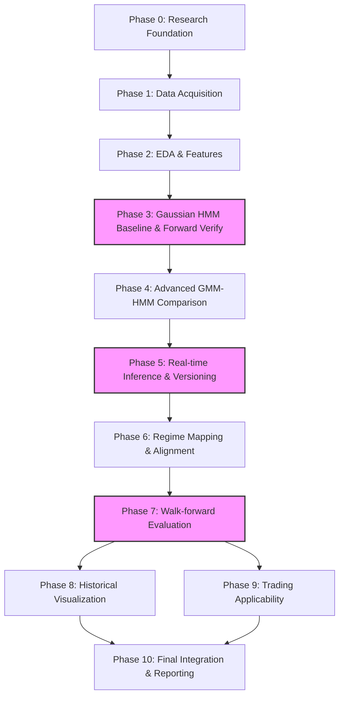

# WORK PLAN: EURUSD M15 Market Regime Detection Using Hidden Markov Models

## TỔNG QUAN DỰ ÁN (PROJECT BACKGROUND)
**Mục tiêu cốt lõi:** Phát triển hệ thống nhận diện trạng thái thống kê hiện tại của thị trường EURUSD trên khung thời gian M15 và ước lượng phân phối xác suất lọc (filtered probability distribution): 
$P(S_t=j \mid O_{1:t})$
Hệ thống không nhằm mục đích dự báo hướng đi của nến tiếp theo, không dự báo giá, và không tối đa hóa lợi nhuận giao dịch. Đầu ra bao gồm: Xác suất lọc thời gian thực, lưu trữ lịch sử xác suất "as-of", diễn giải thống kê các trạng thái, đánh giá walk-forward ngoài mẫu, và một lớp đánh giá ứng dụng giao dịch (trading applicability) độc lập. Không ép buộc mô hình phải có chính xác 3 trạng thái hoặc mọi trạng thái ẩn đều phải ánh xạ cứng nhắc thành Bullish, Sideways, hoặc Bearish nếu dữ liệu không hỗ trợ.

---

## LỘ TRÌNH CÁC GIAI ĐOẠN (PHASES)

### PHASE 0 — Research Foundation and Methodology
1. **Mục tiêu:** Định nghĩa phạm vi nghiên cứu, các giả định toán học, ranh giới giữa nhận diện (detection) và dự báo (prediction).
2. **Lý do cần thiết:** Tránh sai lệch mục tiêu khi triển khai kỹ thuật, đảm bảo không có rò rỉ dữ liệu tương lai (look-ahead bias) ngay từ khâu thiết kế.
3. **Nhiệm vụ chi tiết:**
   - Lập bảng ánh xạ phương pháp luận từ 4 bài báo tham khảo.
   - Định nghĩa toán học cho xác suất lọc (filtered probabilities) $P(S_t | O_{1:t})$, phân biệt rõ với xác suất làm mượt (smoothed probabilities) và giải mã Viterbi toàn chuỗi (full-sequence Viterbi decoding).
   - Thiết lập các giới hạn nghiên cứu: Hệ thống nhận diện trạng thái, không phải hệ thống sinh tín hiệu giao dịch.
   - Ghi nhận các quyết định phương pháp luận chưa chốt (unresolved decisions) để thử nghiệm thực nghiệm.
4. **Phương pháp, thuật toán & toán học:** Lý thuyết Hidden Markov Model, Xác suất và Thống kê chuỗi thời gian.
5. **Công cụ / Thư viện:** LaTeX (cho tài liệu), Markdown.
6. **Đầu ra mong đợi:** Tài liệu RESEARCH_PLAN.md, Methodology decision record.
7. **Tiêu chí hoàn thành:** Phạm vi nghiên cứu được định nghĩa toán học rõ ràng; phân định rạch ròi giữa Filtered, Smoothed và Viterbi.
8. **Phụ thuộc:** Không có.
9. **Rủi ro & Sai lầm thường gặp:** Nhầm lẫn khái niệm giải mã hồi cứu với ước lượng xác suất thời gian thực.

### PHASE 1 — Data Acquisition and Quality Control
1. **Mục tiêu:** Thu thập, kiểm tra chất lượng và xử lý dữ liệu OHLC M15 EURUSD.
2. **Lý do cần thiết:** HMM rất nhạy cảm với cấu trúc chuỗi thời gian. Xử lý sai các khoảng trống thời gian sẽ phá vỡ tính hợp lệ của ma trận chuyển trạng thái. Tuyệt đối không bịa đặt (fabricate) nến OHLC.
3. **Nhiệm vụ chi tiết:**
   - Tải dữ liệu OHLC lịch sử EURUSD M15 (VD: từ Dukascopy hoặc MetaTrader 5).
   - Phân biệt rõ: (1) Khuyết 1 nến trong phiên giao dịch, (2) Khuyết nhiều nến liên tiếp trong phiên, (3) Khoảng trống đóng cửa (Cuối tuần, Lễ), (4) Dữ liệu OHLC không hợp lệ (invalid).
   - Đồng bộ hóa múi giờ và kiểm tra Daylight Saving Time (DST).
   - Trích xuất Tick volume và ghi chú rõ đây không phải là Traded volume tập trung.
4. **Phương pháp, thuật toán & toán học:** Time-series integrity checks, Timezone handling.
5. **Công cụ / Thư viện:** Python, Pandas.
6. **Đầu ra mong đợi:** Raw dataset, Data quality report, Reproducible data-loading scripts.
7. **Tiêu chí hoàn thành:** Tập dữ liệu sạch, có chính sách rõ ràng cho từng loại khoảng trống thời gian, không nội suy dữ liệu giả mạo.
8. **Phụ thuộc:** Phase 0.
9. **Rủi ro & Sai lầm thường gặp:** Nội suy nến cuối tuần làm sai lệch xác suất chuyển trạng thái ngầm.

### PHASE 2 — Exploratory Data Analysis and Feature Engineering
1. **Mục tiêu:** Khám phá phân phối dữ liệu, xây dựng và đánh giá các đặc trưng ứng viên (candidate features) đại diện cho M15.
2. **Lý do cần thiết:** HMM cần đầu vào có phân phối phù hợp. Đặc trưng dư thừa hoặc rò rỉ sẽ làm hỏng mô hình.
3. **Nhiệm vụ chi tiết:**
   - Đánh giá các ứng viên: Close-to-close log return, Open-to-close log body return, High-low log range.
   - Bổ sung định nghĩa đặc trưng râu nến (Wicks) sử dụng giá OHLC:
     * $UpperWick_t = \ln\left(\frac{H_t}{\max(O_t, C_t)}\right)$
     * $LowerWick_t = \ln\left(\frac{\min(O_t, C_t)}{L_t}\right)$
     * *Ý nghĩa tài chính:* Đo lường áp lực từ chối giá (price rejection) tại các vùng đỉnh/đáy cục bộ.
   - Phân tích tính phi chuẩn, biến động cụm và ma trận tương quan.
   - Chạy các thử nghiệm cắt bỏ (ablation experiments) và so sánh ngoài mẫu để chốt tập đặc trưng.
   - Đảm bảo các tham số Scaling chỉ được fit trên tập Train. Kiểm tra kỹ rò rỉ nếu dùng rolling features.
4. **Phương pháp, thuật toán & toán học:** Pearson/Spearman correlation, Phân phối thống kê, Log-transform.
5. **Công cụ / Thư viện:** SciPy, Seaborn, Pandas.
6. **Đầu ra mong đợi:** Báo cáo EDA, Feature definitions, Candidate feature datasets.
7. **Tiêu chí hoàn thành:** Chốt danh sách đặc trưng dựa trên bằng chứng ablation, không mặc định tính độc lập thống kê nếu chưa kiểm định, không rò rỉ tương lai.
8. **Phụ thuộc:** Phase 1.
9. **Rủi ro & Sai lầm thường gặp:** Mặc định các đặc trưng là độc lập; fit Scaler trên toàn bộ tập dữ liệu (leakage).

### PHASE 3 — Gaussian HMM Baseline and Forward Filtering Verification
1. **Mục tiêu:** Cài đặt mô hình Gaussian HMM cơ sở và kiểm chứng chặt chẽ thuật toán Forward Filtering.
2. **Lý do cần thiết:** Thiết lập một mốc chuẩn (baseline) và đảm bảo động cơ tính toán xác suất thời gian thực hoạt động đúng toán học.
3. **Nhiệm vụ chi tiết:**
   - Cài đặt Gaussian HMM, thử nghiệm số lượng trạng thái $K \in \{2, 3, 4\}$. Khởi tạo bằng K-Means.
   - Cài đặt thuật toán Forward Filtering để xuất ra xác suất lọc: 
     $\alpha_t(j) = \left[\sum_{i=1}^{K}\alpha_{t-1}(i)a_{ij}\right] \mathcal{N}(O_t \mid \mu_j, \Sigma_j)$
   - Thực hiện tính toán trong không gian logarit (log-space computation) với `LogSumExp` để tránh numerical underflow.
   - Chuẩn hóa: $P(S_t=j \mid O_{1:t}) = \frac{\alpha_t(j)}{\sum_k \alpha_t(k)}$.
   - **Viết Unit Tests bắt buộc:** 
     1. Chuẩn hóa xác suất ($\sum = 1$).
     2. Tính nhất quán giữa lọc tuần tự (sequential) và lô (batch).
     3. Dữ liệu tương lai không ảnh hưởng đến xác suất lọc quá khứ (khi cố định tham số).
     4. Độ ổn định số học trong không gian logarit.
     5. Khởi tạo đúng đắn trạng thái $\alpha_0$.
   - *Lưu ý quan trọng:* Vượt qua các unit tests này chỉ xác thực hành vi của mã nguồn (implementation behavior) về mặt toán học, hoàn toàn không chứng minh chất lượng hay độ chính xác của mô hình dự báo.
4. **Phương pháp, thuật toán & toán học:** Forward Algorithm, Log-space arithmetic, Expectation-Maximization (EM) cho In-sample.
5. **Công cụ / Thư viện:** Custom Python code cho Inference, `hmmlearn` (chỉ dùng để ước lượng tham số In-sample).
6. **Đầu ra mong đợi:** Baseline model, Verified Forward Filtering implementation, Unit test logs.
7. **Tiêu chí hoàn thành:** Thuật toán Forward vượt qua 100% unit tests, không có hiện tượng underflow.
8. **Phụ thuộc:** Phase 2.
9. **Rủi ro & Sai lầm thường gặp:** Tự động cho rằng hàm `predict_proba()` của thư viện sinh ra Filtered probabilities mà không kiểm tra API thực tế.

### PHASE 4 — Advanced Model Comparison: Multivariate GMM-HMM
1. **Mục tiêu:** Đánh giá GMM-HMM đa biến như một ứng viên nâng cao (advanced candidate) để xem xét khả năng giải quyết phân phối phi chuẩn.
2. **Lý do cần thiết:** Đánh giá khách quan GMM-HMM thay vì tự động mặc định nó là ưu việt.
3. **Nhiệm vụ chi tiết:**
   - Cài đặt GMM-HMM với hàm phát xạ: $b_j(O_t) = \sum_{m=1}^M w_{jm} \mathcal{N}(O_t \mid \mu_{jm}, \Sigma_{jm})$.
   - Đánh giá các mô hình ứng viên thông qua quy trình minh bạch:
     1. **Sequential Out-of-sample (OOS) predictive log-likelihood:** Xác suất dự báo của quan sát $O_t$ phải được tính *trước khi* tích hợp phát xạ của chính $O_t$ vào phân phối: 
        $\log P(O_t \mid O_{1:t-1}, \Theta_{\text{train}}) = \log \sum_j \left[ \sum_i \alpha_{t-1}(i)a_{ij} \right]b_j(O_t)$
        *Lưu ý:* Chỉ sử dụng các tham số $\Theta_{\text{train}}$ được ước lượng từ tập huấn luyện, không refit (huấn luyện lại) mô hình trên quan sát đang được đánh giá.
     2. Độ ổn định và thời lượng trạng thái.
     3. Tần suất chuyển pha.
     4. Tính diễn giải tài chính.
     5. Độ nhạy với khởi tạo (Initialization sensitivity) và chi phí tính toán.
   - AIC/BIC chỉ đóng vai trò tiêu chí hỗ trợ trên tập In-sample.
   - Không mặc định sử dụng $K=3, M=3$. Giá trị này là các quyết định mang tính thực nghiệm cho dự án này.
4. **Phương pháp, thuật toán & toán học:** GMM-HMM, Sequential OOS Log-Likelihood, Information Criteria.
5. **Công cụ / Thư viện:** `hmmlearn`, Custom evaluation scripts.
6. **Đầu ra mong đợi:** Candidate models, Model comparison report, Mô hình kiến trúc được chọn.
7. **Tiêu chí hoàn thành:** Chọn mô hình cân bằng giữa OOS LL, khả năng diễn giải và chi phí tính toán. Không sử dụng một điểm số hỗn hợp tự chế.
8. **Phụ thuộc:** Phase 3.
9. **Rủi ro & Sai lầm thường gặp:** Tự động cho rằng GMM-HMM giải quyết được hoàn toàn các cú sốc tin tức.

### PHASE 5 — Real-time Inference, Model Versioning, and Retraining Management
1. **Mục tiêu:** Quản lý quy trình cập nhật thời gian thực, xử lý quan sát khuyết, lưu trữ metadata bất biến, và khởi tạo lại mô hình khi retraining.
2. **Lý do cần thiết:** Đảm bảo tính liên tục trong thời gian thực khi đối mặt với dữ liệu thực tế (nến khuyết, cuối tuần) và bảo toàn tính bất biến (immutable) của các xác suất đã ghi nhận trong quá khứ.
3. **Nhiệm vụ chi tiết:**
   - Tích hợp hàm Forward Filtering (Phase 3) vào luồng xử lý Incremental updates cho từng nến M15.
   - **Chính sách Xử lý nến khuyết (Missing-observation handling):** 
     1. *Khuyết 1 nến hoặc nhiều nến liên tiếp trong phiên giao dịch đang mở:* Bỏ qua bước cập nhật phát xạ, lan truyền xác suất hợp lệ bằng ma trận chuyển đổi: $\boldsymbol{\alpha}_{t+n} = \boldsymbol{\alpha}_t A^n$.
     2. *Khoảng trống đóng cửa (Cuối tuần/Lễ) & Dữ liệu Invalid:* Không tự động đếm mọi khoảng 15 phút lịch như một bước chuyển đổi HMM. Cần thiết lập một **chính sách lịch giao dịch (trading-calendar policy)** rõ ràng. Đánh giá xem nên tiếp tục lan truyền qua $A$ hay có quy tắc tái khởi tạo riêng. Không tự bịa ra một ngưỡng reset phổ quát.
   - **Khởi tạo lại mô hình (Retraining Initialization):** Khi phiên bản mô hình mới $\Theta_{\text{new}}$ được huấn luyện, KHÔNG tái sử dụng trực tiếp vector $\alpha_t$ cũ. 
     * Lọc lại (re-filter) một khoảng dữ liệu huấn luyện (warm-up window) bằng $\Theta_{\text{new}}$ để lấy $\alpha_t$ mới nhất.
     * Bắt đầu ghi nhận xác suất "as-of" mới khi mô hình mới chính thức kích hoạt.
   - **Metadata & Lưu trữ Bất biến:** Các bản ghi xác suất "as-of" lịch sử không được ghi đè khi retrain. Mỗi bản ghi bắt buộc chứa: Timestamp, Model version, Feature version, Probability vector, và Data-quality/missing-observation status. Phân biệt rõ mảng "as-of" này với mảng xác suất hồi cứu (retrospective probabilities) được tính toán lại bằng mô hình đời sau.
4. **Phương pháp, thuật toán & toán học:** Markov chain state propagation, Transition matrix exponentiation, Immutable data logging.
5. **Công cụ / Thư viện:** JSON/Parquet (lưu trữ metadata mô hình và version).
6. **Đầu ra mong đợi:** Inference Engine, Immutable probability records, Missing-observation policy.
7. **Tiêu chí hoàn thành:** Hệ thống chạy liên tục, nạp nến mới, cập nhật xác suất chính xác, chính sách lịch giao dịch rõ ràng.
8. **Phụ thuộc:** Phase 4.

### PHASE 6 — Regime Interpretation and Label Alignment
1. **Mục tiêu:** Ánh xạ các trạng thái ẩn ($1 \dots K$) sang ngữ nghĩa tài chính và duy trì sự ổn định nhãn qua các lần retrain.
2. **Lý do cần thiết:** Trạng thái ẩn không có ý nghĩa nội tại và có thể bị hoán đổi (label switching) do bản chất hoán vị của mô hình latent-state.
3. **Nhiệm vụ chi tiết:**
   - **Trích xuất đặc tính:** Phân biệt rõ 3 khái niệm:
     1. Thời lượng tính từ một chuỗi giải mã cụ thể (decoded state sequence durations).
     2. Kỳ vọng thời lượng ước lượng từ ma trận chuyển trạng thái (expected durations estimated from transition matrix).
     3. Đặc tính trạng thái trọng số hậu nghiệm (posterior-weighted state characteristics).
     *Lưu ý:* Không được ngầm hiểu chúng là một. Sử dụng xác suất làm mượt (smoothed posterior weights) để định hình đặc tính (Mean, Volatility, Covariance) **CHỈ trên tập Training**.
   - Không ép buộc mô hình phải có đúng 3 nhãn. Có thể định nghĩa một trạng thái "Choppy/High-volatility/Turbulence" độc lập với Sideways. 
   - Không tự động cho rằng Bearish tương đương với rủi ro cao (high risk).
   - **Quy trình so khớp (Matching procedure):** Dựa trên đặc tính (không dựa trên nhãn test). Đánh giá độ bao phủ ánh xạ (matching coverage), khoảng cách tương đồng đặc tính (characteristic similarity distance), tần suất các trạng thái mơ hồ, và các trạng thái không khớp (unmatched states).
   - **Không** áp đặt yêu cầu tỷ lệ khớp > 90% khi không có nhãn gốc (ground-truth). Thiết lập luật cho các trạng thái không khớp.
4. **Phương pháp, thuật toán & toán học:** Smoothed Posterior Weighting (In-sample only), Characteristic similarity distance.
5. **Công cụ / Thư viện:** NumPy, Pandas.
6. **Đầu ra mong đợi:** State interpretation report, Mapping rules, Label alignment procedure.
7. **Tiêu chí hoàn thành:** Quy tắc ánh xạ được thiết lập hoàn toàn dựa trên tập Train, giải quyết ổn thỏa label switching.
8. **Phụ thuộc:** Phase 5.

### PHASE 7 — Walk-forward Evaluation and Robustness Analysis
1. **Mục tiêu:** Đánh giá hiệu suất mô hình liên tục trên trục thời gian thực thông qua cơ chế Walk-forward.
2. **Lý do cần thiết:** Đánh giá một lần (single split) không phản ánh được khả năng thích ứng của hệ thống trong môi trường phi dừng (non-stationary).
3. **Nhiệm vụ chi tiết:**
   - Thiết lập các cửa sổ Train, Validation, và Test theo trình tự thời gian. Mọi khâu (Scaler, Feature selection, Model selection, Mapping, Thresholds) đều tuyệt đối cấm rò rỉ dữ liệu từ tập Test.
   - Đánh giá **Rủi ro cấp độ Pha (Regime-level Risk)**: Conditional Mean, Volatility, VaR, ES gắn với từng pha. Coi việc "Bearish/Turbulence có rủi ro cao hơn" là một **giả thuyết cần kiểm định**, không phải quy định hoàn thành.
   - Đánh giá **Rủi ro cấp độ Chiến lược (Strategy-level Risk)**: Tính Maximum Drawdown (MaxDD) bắt buộc trên **đường cong vốn/giá liên tục (continuous chronological equity curve)**. Nếu báo cáo MaxDD cho từng pha riêng biệt, phải định nghĩa rõ công thức tính toán và giải thích giới hạn khi các chuỗi thời gian của một pha bị cắt rời (disconnected returns).
   - **Lưu ý phụ thuộc nối tiếp (Serial Dependence):** Cảnh báo rõ ràng về giới hạn của kiểm định Kruskal-Wallis đối với các chuỗi tài chính có tính phụ thuộc nối tiếp. Đề cập đến block bootstrap hoặc các phương pháp xử lý phụ thuộc (dependence-aware methods) nếu cần thiết để đưa ra tuyên bố suy diễn (inferential claims).
4. **Phương pháp, thuật toán & toán học:** Walk-forward validation, Risk metrics (ES, VaR, Continuous MaxDD, Block bootstrap).
5. **Công cụ / Thư viện:** Custom Walk-forward framework.
6. **Đầu ra mong đợi:** Walk-forward results, Robustness analysis report.
7. **Tiêu chí hoàn thành:** Quy trình Walk-forward hoàn toàn sạch (zero leakage).
8. **Phụ thuộc:** Phase 6.

### PHASE 8 — Historical Regime Visualization
1. **Mục tiêu:** Trực quan hóa chuỗi giá EURUSD song song với phân phối xác suất trạng thái lọc (Filtered Probabilities).
2. **Lý do cần thiết:** Cung cấp công cụ trực quan để nhà nghiên cứu kiểm chứng tính hợp lý của mô hình, nhận biết các vùng bất định.
3. **Nhiệm vụ chi tiết:**
   - Trực quan hóa giá EURUSD và biểu đồ miền của xác suất lọc $P(S_t \mid O_{1:t})$.
   - Phân biệt rõ ranh giới giữa ma trận chuyển trạng thái của mô hình (Model transition matrix) và tần suất chuyển pha thực nghiệm quan sát được trong lịch sử (Empirical historical transition frequencies).
   - Có thể sử dụng Viterbi decoding toàn chuỗi (full-sequence Viterbi) **chỉ cho mục đích phân tích hồi cứu offline (retrospective analysis)**.
4. **Phương pháp, thuật toán & toán học:** Data alignment, Time-series visualization.
5. **Công cụ / Thư viện:** Plotly, Matplotlib.
6. **Đầu ra mong đợi:** Historical regime visualization, Empirical transition analysis.
7. **Tiêu chí hoàn thành:** Biểu đồ phản ánh chính xác các xác suất "as-of" đã lưu trữ ở Phase 5.
8. **Phụ thuộc:** Phase 7 (Tiến hành song song với Phase 9).

### PHASE 9 — Trading Applicability Evaluation
1. **Mục tiêu:** Đánh giá xem thông tin trạng thái thị trường có tạo ra giá trị ngữ cảnh (contextual value) cho hệ thống giao dịch hay không.
2. **Lý do cần thiết:** Đánh giá giá trị thực tiễn (contextual value) của hệ thống Regime Detection, không nhằm mục đích tối ưu hóa lợi nhuận.
3. **Nhiệm vụ chi tiết:**
   - **Định nghĩa P(Turbulence):** 
     $P(\text{Turbulence}_t) = \sum_{j \in \mathcal{T}} P(S_t=j \mid O_{1:t})$
     Với $\mathcal{T}$ là tập hợp các trạng thái ẩn được phân loại là nhiễu loạn/rủi ro cao, sử dụng **dữ liệu tập Train** để xác định và đóng băng trước khi đánh giá trên Test. Các xác suất này là xác suất lọc tại thời điểm $t$, không phải xác suất làm mượt. Tuyệt đối không tự động đánh đồng Bearish với Turbulence.
   - Lựa chọn ngưỡng kích hoạt bộ lọc hoàn toàn bằng dữ liệu Train/Validation, không tối ưu hóa (optimize) trên tập Test cuối cùng.
   - Thiết lập Baseline Strategy và Comparison Strategy (dùng chung logic vào/ra lệnh cơ sở, nhưng bị chi phối bởi bộ lọc $P(\text{Turbulence})$).
   - **Giả định thực thi:** Tín hiệu sinh ra khi đóng nến (candle close), khớp lệnh lúc mở nến sau (next candle open). Áp dụng spread, commission, slippage thực tế và quy mô vị thế minh bạch.
4. **Phương pháp, thuật toán & toán học:** Event-driven backtesting, Transaction cost modeling.
5. **Công cụ / Thư viện:** Vectorized/Event-driven backtester.
6. **Đầu ra mong đợi:** Trading hypotheses, Backtesting results, Applicability assessment.
7. **Tiêu chí hoàn thành:** So sánh công bằng cùng một logic cốt lõi. Giả định chi phí minh bạch.
8. **Phụ thuộc:** Phase 5, 6, 7 (Không phụ thuộc Phase 8).

### PHASE 10 — Final System Integration and Research Reporting
1. **Mục tiêu:** Đóng gói mã nguồn, viết báo cáo học thuật minh bạch.
2. **Nhiệm vụ chi tiết:**
   - Tích hợp pipeline hoàn chỉnh: Dữ liệu -> Đặc trưng -> Inference -> Lưu trữ.
   - Báo cáo sự bất định (uncertainty) của mô hình.
   - Xây dựng tài liệu hướng dẫn tái lập (reproducibility instructions).
3. **Đầu ra mong đợi:** Working prototype, Research report, Technical documentation.
4. **Phụ thuộc:** Phase 8, Phase 9.

---

## METHODOLOGY-TO-PAPER TRACEABILITY MATRIX

| Phase | Task / Method | Reference Paper | Exact Method or Idea Inherited | Adaptation to EURUSD M15 | Why Adaptation Is Necessary |
| :--- | :--- | :--- | :--- | :--- | :--- |
| **Phase 2** | Feature Engineering | Paper 1 | Cấu trúc đặc trưng mô tả nến nội nhật ($r_{OC}, r_{OH}, r_{OL}$)[cite: 6]. | Kế thừa $r_{OC}$. Đề xuất thử nghiệm thêm $UpperWick_t$ và $LowerWick_t$. | Tối ưu hóa tính đại diện, tránh bùng nổ chiều dư thừa của râu nến. |
| **Phase 4** | Model Architecture | Paper 1 | Xem xét Multivariate GMM-HMM. (Bài báo báo cáo N=3, M=3 có AIC/BIC thấp nhất trong thực nghiệm của họ[cite: 6]). | K/M là quyết định thực nghiệm, không kế thừa mặc định. Thêm OOS Predictive LL. | GMM-HMM dễ Overfitting. Cần Sequential OOS LL thay vì chỉ dùng AIC/BIC in-sample. |
| **Phase 6 & 7** | Regime Risk Evaluation | Paper 1 & 4 | Đánh giá Expected Shortfall (ES), MaxDD, VaR của từng cụm[cite: 10, 11, 87]. | Sử dụng ES, VaR để kiểm định giả thuyết tính chất trạng thái ngầm. | MaxDD phải được tính trên đường cong vốn liên tục, không phải điểm rời rạc. |
| **Phase 7** | Walk-forward Evaluation | Paper 2 | Khung đánh giá Windowed Waterfall Split chống rò rỉ[cite: 26]. | Áp dụng chia cửa sổ nghiêm ngặt cho HMM Inference. Tuân thủ $t_{train} < t_{val} < t_{test}$. | Đảm bảo Scaling, Thresholds và HMM Params không rò rỉ dữ liệu tương lai vào tập Test. |
| **Phase 9** | Trading Filter Application | Paper 3 | Tạm dừng giao dịch khi thị trường ở trạng thái bất thường (Abnormal/Turbulence)[cite: 61, 62]. | Lọc tín hiệu dựa trên Filtered Probabilities. Định nghĩa $\mathcal{T}$ bằng tập Train. | Bài 3 dùng Viterbi toàn chuỗi trong quá trình testing[cite: 61] có thể dùng dữ liệu tương lai để tái cấu trúc trạng thái hồi cứu. Cần dùng Filtered Probabilities cho real-time. |

**Bảng Đối Chiếu Thay Đổi Kế Thừa (Paper Modification Table)**

| Paper | What I inherit | What I modify | What I do not inherit | Reason |
| :--- | :--- | :--- | :--- | :--- |
| **Paper 1** | Multivariate HMM framework, kiểm định cấu hình K/M, ES/MaxDD[cite: 4, 6, 10, 11]. | K/M là biến thực nghiệm, không mặc định N=3, M=3. Xem việc tính ES/MaxDD như kiểm định giả thuyết. | Cấu trúc giải mã toàn chuỗi (Full-sequence Viterbi) làm đầu ra thời gian thực[cite: 7]. | Full-sequence Viterbi có thể sử dụng dữ liệu tương lai để tái cấu trúc lịch sử. Dự án dùng Forward Filtering cho real-time, Viterbi chỉ dành cho retrospective offline. |
| **Paper 2** | Khung đánh giá Windowed Waterfall Split[cite: 26]. | Dùng chia cửa sổ cho HMM Forward thay vì quy trình MKL. | Discriminative Model (SVM/MKL), Generative Embeddings (Fisher score)[cite: 21, 33]. | Dự án là Nhận diện Trạng thái ngầm (Detection), không phải Phân loại Dự báo (Classification Prediction). |
| **Paper 3** | Kế thừa logic bộ lọc rủi ro: Ngưng giao dịch khi Abnormal[cite: 61]. | Dùng Filtered Probabilities thay vì Viterbi toàn chuỗi[cite: 61]. Tách biệt rõ Turbulence và Bearish. | Phương pháp lấy mẫu Directional Change (DC), nhãn Normal/Abnormal[cite: 54, 59]. | Không thuộc phạm vi dự án do dự án giữ nguyên quan sát M15 (lưới thời gian OHLC cố định). |
| **Paper 4** | Khung đánh giá rủi ro VaR/ES, so sánh Markov-Switching vs Smooth Transition[cite: 74, 87]. | Áp dụng concept rủi ro để đánh giá chất lượng của Filtered Probabilities. | Cấu trúc mô hình HAR, MS-TVTP[cite: 74, 76]. | HAR chủ yếu là framework dự báo biến động thực tế (realized-volatility forecasting)[cite: 74]. Dự án này tập trung ước lượng xác suất trạng thái ngầm hiện tại. Giữ HAR làm một extension trong tương lai. |

---

## DEPENDENCY ROADMAP & CRITICAL PATH

*Ghi chú:*

* Phase 8 và Phase 9 được thực hiện song song sau khi Phase 7 hoàn thành.
* Phase 9 phụ thuộc vào đầu ra của Phase 5, 6, 7 chứ không phụ thuộc vào Phase 8.

---

## CÁC QUYẾT ĐỊNH CHƯA CHỐT (UNRESOLVED DECISIONS)

Các thông số dưới đây không được ấn định trước mà phải được quyết định dựa trên thực nghiệm (thông qua Validation set hoặc Out-of-sample LL):

1. **Cửa sổ huấn luyện (Training Window):** Thử nghiệm và so sánh các mốc 60, 90, và 180 ngày lịch (Sẽ quy đổi thành số lượng quan sát thực tế khả dụng sau khi làm sạch dữ liệu).
2. **Chu kỳ tái huấn luyện (Retraining Frequency):** Đánh giá cân bằng giữa hiệu suất (OOS LL) và chi phí tính toán đối với tùy chọn hàng tuần (weekly) hoặc hai tuần một lần (biweekly).
3. **Cấu trúc Mô hình (K, M):** Số lượng trạng thái ngầm $K$ và thành phần hỗn hợp $M$ (nếu dùng GMM) sẽ được đánh giá độc lập. Không ép buộc cấu hình từ các bài báo gốc.
4. **Chính sách lịch giao dịch (Trading-Calendar Policy):** Quyết định quy tắc tái khởi tạo (reinitialization) hoặc lan truyền xác suất qua các khoảng trống nghỉ lễ dài.
5. **Chi phí Giao dịch (Trading Costs):** Xác định các giả định Spread, Commission, Slippage dựa trên tài liệu được ghi nhận rõ ràng từ một nguồn broker thực tế. Cấm dùng giả định zero-cost.
